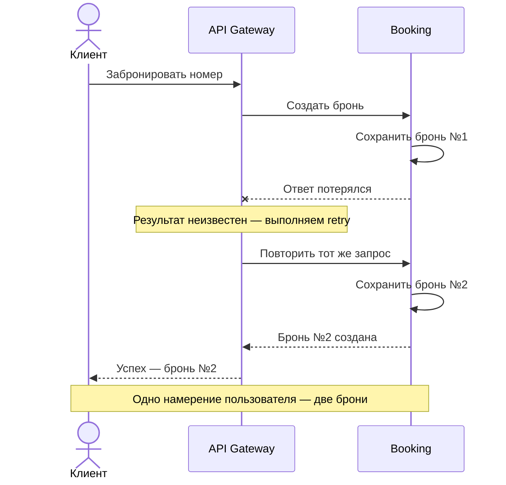

# 🔑 Идемпотентность: почему мы добавляли каждую защиту

**Разбор решений из урока 3 · около 8 минут**

[Задание](../README.md) · [Ретраи](retries.md)

Разберём путь **API Gateway → Booking** из лекционного hotel: сначала защитим одну команду от повторного выполнения, затем разберём конкурентные запросы и новое действие по устаревшему списку броней.

## 1. Зачем нужен ключ идемпотентности

### Бронь создалась, а пользователь увидел ошибку

Пользователь нажал «Забронировать». Booking сохранил бронь, но соединение оборвалось до получения ответа. Gateway видит `Unavailable`, либо клиент дожидается timeout. **Результат операции ему неизвестен.**

Если каждое обращение создаёт новую бронь и нет защиты от повторного эффекта, получится так:



Такой же повтор может отправить клиент после повторного нажатия кнопки. В системах с оплатой повторное выполнение способно привести и к повторному списанию. **Retry повторяет запрос, но сам не отличает новую команду от уже выполненной.**

В готовом hotel также есть запрет пересечения броней одного номера. Он может остановить вторую вставку, но вернёт ошибку занятости вместо результата первой команды. Это бизнес-ограничение, а клиенту нужно узнать результат собственного бронирования.

### Решение из лекции: узнавать команду по ключу

Клиент генерирует `idempotency_key` **до первой отправки** и сохраняет его для всех повторов одного намерения. Новое осознанное бронирование получает новый ключ. В hotel используется UUID в поле запроса; Gateway передаёт его в Booking неизменным.

В [CreateBooking][create] прежде новой операции ищем результат по паре **гость + ключ**:

```go
existing, err := s.storage.FindByKey(ctx, booking.GuestID(), input.IdempotencyKey)
if err != nil {
	return nil, err
}
if existing != nil {
	return existing.Replay(booking)
}
// Только для нового ключа продолжаем создание брони.
```

Теперь после потери ответа повтор с тем же ключом вернёт **ту же бронь с тем же ID**, без новой записи и события. Поиск идёт до обращения к Hotels: повтору принятой команды не нужно заново выполнять её зависимости.

> 📌 **Один ключ — одно намерение**
>
> Генерировать новый ключ внутри retry-цикла нельзя: сервер увидит разные команды. `request_id` для трассировки тоже не заменяет ключ идемпотентности.

### Почему одного совпадения ключа недостаточно

Допустим, клиент повторно прислал прежний ключ, но изменил номер или даты. Возвращать старую бронь как результат нового запроса — ошибка. Поэтому проверяем **fingerprint**: значимые поля команды.

В hotel это прямое сравнение полей, без отдельного хеша JSON. Фрагмент [Replay][entity]:

```go
if b.guestID != request.guestID || b.roomID != request.roomID || !b.period.Equal(request.period) {
	return nil, app.NewConflictErr("Ключ идемпотентности уже использован для другой брони")
}
return b, nil
```

`request_id` и версия списка не входят в fingerprint: они не меняют намерение забронировать конкретный номер на конкретный период. Возвращается текущее состояние сохранённой брони; контракт не обещает побайтовую копию первого ответа.

## 2. Почему нельзя оставить только `FindByKey`

После добавления поиска возникает соблазн убрать уникальность в БД: «Мы ведь уже проверили, что ключа нет». Но между чтением и записью другой запрос может сделать то же самое.

Повторы бывают конкурентными: клиент прекратил ждать, а первый серверный обработчик ещё выполняется; пользователь отправил команду из двух вкладок. Рассмотрим защиту по ключу отдельно от версии списка и проверки занятости:

| Момент | Обработчик A | Обработчик B |
| --- | --- | --- |
| 1 | `FindByKey(K)` → ничего | |
| 2 | | `FindByKey(K)` → ничего |
| 3 | Выполнил логику, сохранил бронь с K | |
| 4 | | Выполнил логику, сохранил ещё одну бронь с K |

Оба обработчика честно прошли проверку. **`FindByKey` не резервирует ключ.** Обычная транзакция с чтением и последующей вставкой сама по себе эту гонку не устраняет.

### Решение из лекции: уникальность и атомарное сохранение

В [таблице bookings][migration] оставляем:

```sql
unique (guest_id, idempotency_key)
```

БД не позволит закоммитить две строки с одним ключом у одного гостя, даже если запросы пришли в разные процессы. Поиск нужен для возврата прежнего результата; уникальность — для защиты конкурентной записи.

Ключ хранится **в самой строке брони**. Бронь и событие в outbox сохраняются одной транзакцией. Поэтому нет окна «бронь уже создали, но ключ ещё не записали» и повтор не создаёт второй набор изменений.

В текущем hotel проигравший конкурентный запрос может получить конфликт. Повтор с тем же ключом после завершения победителя прочитает сохранённую бронь. Не нужно обещать, что оба одновременных запроса сразу вернут успех.

> ⚠️ **Граница защиты**
>
> Уникальность в БД защищает локальную запись. Если перед ней выполнить внешнее списание денег, откат БД его не отменит. Внешний сервис тоже должен поддерживать безопасный повтор со стабильным ключом; наши бронь и outbox сохраняются локально и атомарно.

## 3. Зачем после ключа понадобилась версия списка

Ключ защищает **повтор той же команды**. Но пользователь может работать со старым экраном и отправить новую команду с новым ключом.

Вернёмся к потере ответа: первая бронь сохранилась, а в интерфейсе её нет. Пользователь выбирает другой доступный номер и снова нажимает «Забронировать». Новый ключ корректен, поля тоже корректны, пересечений с первой бронью нет. Проверка ключа пропустит запрос — хотя решение принято потому, что пользователь не увидел первую бронь.

### Решение из лекции: передавать версию прочитанного списка

`ListBookings` возвращает список вместе с `bookings_version`. Клиент передаёт её в `CreateBooking`: «Я принимаю решение на основании этой версии списка». Новая команда допустима, только если состояние ещё не изменилось.

| Событие | Результат |
| --- | --- |
| Клиент прочитал список | Версия **7** |
| Создание с ключом **A**, версия **7** | Бронь сохранена, версия стала **8**, ответ потерян |
| Повтор **A + 7**, прежние номер и даты | Возвращаем сохранённую бронь |
| Вместо повтора — новая команда **B + 7**, например на другой номер | Конфликт: список уже изменился |
| Клиент обновил список | Видит первую бронь и решает, нужно ли ещё одно бронирование |

**A и B — условные обозначения разных UUID.** Строки с A + 7 и B + 7 показывают два возможных действия после потери ответа.

> 📌 **Порядок имеет значение**
>
> Сначала ищем прежний ключ и проверяем fingerprint. Версию списка проверяем только для новой команды. Иначе собственная успешная запись сделает корректный повтор A + 7 «устаревшим».

### Как версия защищает от конкуренции

В [Confirm][confirm] ранняя проверка выглядит просто:

```go
if expectedVersion != version.Current() {
	return nil, app.NewConflictErr("Список броней изменился. Обновите список перед новой операцией")
}
```

Но два запроса могут одновременно прочитать версию 7. Поэтому [запись версии][list] использует **CAS** — изменение только при совпадении предыдущего значения:

```sql
insert into public.bookings_state (guest_id, version)
values ($1, $2)
on conflict (guest_id) do update
set version = excluded.version
where bookings_state.version = $3
```

`$1` — гость, `$2` — новая версия, `$3` — предыдущая. Если затронута не одна строка, возвращаем конфликт. Проверка версии и запись результата связаны одной транзакцией:

```text
transaction.Exec
  → version.Inc()
  → UpdateBookingsVersion: CAS, иначе ошибка
  → Create: бронь и ключ
  → Flush: событие в outbox
  → commit, либо rollback при ошибке
```

Если создание не удалось, увеличение версии откатится вместе с ним. Список и его версия читаются в одном снимке БД (`RepeatableRead`), чтобы клиент не получил старые строки с новой версией. Создание, активация и отмена меняют версию списка гостя; replay — нет.

Версия не определяет, являются ли две команды одинаковыми: это задача ключа и fingerprint. Она запрещает новую запись по устаревшему состоянию. После обновления списка осознанное бронирование с новым ключом и актуальной версией разрешено, если соблюдены бизнес-правила.

## 4. Чеклист: ключи идемпотентности и контракт API

### 🔑 Как применять ключи

- [ ] **Генерировать на клиенте до отправки.** Сохранять один ключ и смысловые поля для сетевых и ручных повторов одной команды.
- [ ] **Ограничить область ключа.** В hotel это `guest_id + idempotency_key`; владелец определяется контекстом пользователя. При общей таблице ключей разных команд учитывайте также вид операции.
- [ ] **Определить fingerprint.** Сравнивать значимые поля; прежний ключ с другим содержимым отклонять.
- [ ] **Сохранять ключ и результат атомарно.** Обеспечить уникальность в БД, не полагаться на один `FindByKey`. Для внешних эффектов предусмотреть защиту у их владельца.
- [ ] **Задать срок действия защиты.** В hotel отдельного TTL нет — ключ хранится с бронью. При очистке срок должен покрывать разрешённый период повторов; после удаления ключа гарантии replay больше нет.

### 🧩 Как оформить API

- [ ] **Явно задать место и формат ключа.** В hotel обязательный UUID `idempotency_key` передаётся в теле запроса. Не генерировать новый ключ в Gateway при повторе; отсутствие или неверный формат — ошибка входа.
- [ ] **Описать результат повтора.** Тот же ключ и fingerprint возвращают тот же ID брони и её текущее состояние без нового эффекта.
- [ ] **Различать причины конфликтов.** Другой fingerprint с прежним ключом и устаревшая версия списка требуют разных действий клиента, хотя оба могут иметь статус HTTP 409 / gRPC `Aborted`.
- [ ] **Описать неопределённый результат.** После timeout или потери ответа клиент повторяет прежнюю команду с прежним ключом. Для конкурирующего ещё не завершённого запроса заранее определить ответ; в hotel возможен конфликт, после завершения — replay.
- [ ] **Связать чтение и новую команду версией.** Возвращать `bookings_version` со списком и принимать её при создании. После успеха обновлять список: `CreateBooking` в hotel не возвращает новую версию коллекции.
- [ ] **Определить реакцию на устаревшую версию.** Обновить список и пересмотреть необходимость новой команды. Не подставлять свежую версию автоматически, повторяя создание с новым ключом.

### Термины под рукой

**Idempotency key** — идентификатор намерения; **fingerprint** — значимые поля команды; **replay** — возврат сохранённого результата; **TTL** — срок хранения защиты; **версия списка** — номер состояния коллекции; **CAS** — условная запись по ожидаемой версии.

В Scooter пример защиты ключом уже есть в [Rental.Reserve](../../../services/rental/internal/application/usecase/rental/reserve/usecase.go). Версия списка разобрана здесь на hotel как приём из лекции; внедрять её в рамках ДЗ по ретраям не требуется.

[create]: https://github.com/f0rmul11/fault-tolerance-hotel/blob/438451e20e455a94fc7f728e157ccd1436431386/services/booking/internal/application/usecase/booking/create/usecase.go
[entity]: https://github.com/f0rmul11/fault-tolerance-hotel/blob/438451e20e455a94fc7f728e157ccd1436431386/services/booking/internal/domain/entity/booking.go
[migration]: https://github.com/f0rmul11/fault-tolerance-hotel/blob/438451e20e455a94fc7f728e157ccd1436431386/services/booking/tools/migrations/20261011000100_create_bookings.sql
[confirm]: https://github.com/f0rmul11/fault-tolerance-hotel/blob/438451e20e455a94fc7f728e157ccd1436431386/services/booking/internal/application/service/booking/confirm/service.go
[list]: https://github.com/f0rmul11/fault-tolerance-hotel/blob/438451e20e455a94fc7f728e157ccd1436431386/services/booking/internal/infrastructure/storage/booking/list.go
