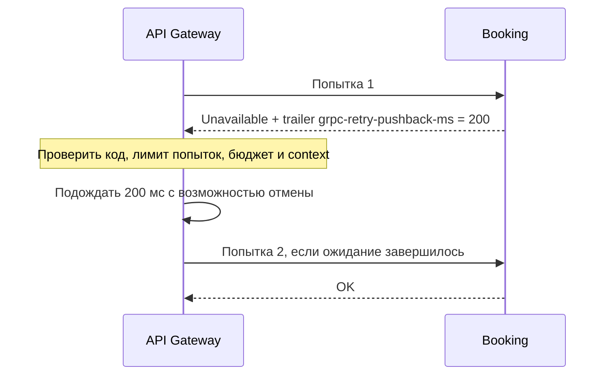

# 🔁 Ретраи: когда применять и как настроить

**Короткая методичка к уроку 3 · около 10 минут**

[Задание](../README.md) · [Идемпотентность](idempotency.md)

> 📝 **Примечание**
>
> Примеры библиотеки и YAML взяты из лекционного **hotel: API Gateway → Booking**. В **Scooter** вы реализуете тот же алгоритм для `API Gateway → Scooter.GetScooter`. Меняются метод и настройки под нагрузку, а не правила работы бюджета.

## 1. Зачем нужны повторы

Зависимость на мгновение недоступна: соединение оборвалось, экземпляр перезапускается, сервер временно перегружен. Следующий вызов может пройти, и пользователь не увидит сбоя.

При длительной аварии повтор не исправляет причину. Если каждый из 20 пользовательских запросов в секунду порождает три попытки, зависимость получает до **60 попыток в секунду**. Если два слоя независимо разрешают по три попытки, последний сервис может получить **до девяти** вызовов на одну операцию.

> 📌 **Важно**
>
> **Лимит попыток ограничивает один запрос. Backoff распределяет повторы во времени. Бюджет ограничивает дополнительные обращения всего потока.** Эти механизмы дополняют друг друга.

### Мини-глоссарий

| Термин | Что означает |
| --- | --- |
| Attempt / попытка | Один вызов зависимости. Первая попытка тоже считается |
| Retry / повтор | Дополнительная попытка после ошибки |
| Transient failure | Временный сбой, который может исчезнуть без изменения запроса |
| Backoff | Правило выбора паузы перед повтором |
| Jitter | Случайное смещение паузы, чтобы клиенты не повторяли одновременно |
| Deadline | Момент, после которого прекращаются и вызовы, и ожидания |
| Retry amplification | Умножение нагрузки из-за повторов, особенно на нескольких слоях |
| Retry budget | Общее ограничение повторов для потока запросов |
| Pushback | Указание сервера: сколько ждать до повтора или что повторять нельзя |

## 2. Чеклист перед включением

- [ ] **Операцию безопасно повторять.** Чтение карточки — да; создание брони — только с защитой от повторного эффекта. См. [идемпотентность](idempotency.md).
- [ ] **Выбран конкретный исходящий метод.** В Scooter это `/scooter.scooter.v1.ScooterService/GetScooter`, а не входной RPC Gateway из команды нагрузки.
- [ ] **Есть явный список ошибок.** Для ДЗ — `Unavailable`. Некорректный запрос, `NotFound` и отмена не лечатся повтором. Timeout записи не доказывает, что запись не состоялась.
- [ ] **Повторами управляет один слой.** Иначе лимиты разных клиентов перемножаются.
- [ ] **Заданы предел попыток, общий deadline и backoff с jitter.** Новый RPC не получает заново весь бюджет времени.
- [ ] **Бюджет живёт дольше одного запроса.** Все конкурентные вызовы используют согласованное состояние.

## 3. Как подключено в hotel

Сокращённый фрагмент [инициализации клиента][client]: объект retry создаётся **при открытии соединения**, а не внутри обработчика каждого запроса.

```go
retries := retry.NewRetry(config.Instance().Retry)

conn, err := grpc.NewClient(address,
	grpc.WithTransportCredentials(insecure.NewCredentials()),
	grpc.WithDisableRetry(),
	grpc.WithChainUnaryInterceptor(
		intercept.ProxyMetadata(),
		retries.UnaryClientInterceptor(),
	),
)
```

`ProxyMetadata` находится снаружи: клиенту нужны metadata итоговой попытки. `WithDisableRetry()` отключает настроенную retry-политику самого grpc-go, чтобы она не работала поверх нашего цикла; прозрачные транспортные повторы эта опция не запрещает.

### Конфигурация метода

Пример включения `CreateBooking` на основе [конфига лекции][config]. Это **демонстрационные значения**, не готовая настройка для SLO 300 мс в Scooter.

```yaml
retry:
  __default__:
    enabled: false
    separate_retry_per_handler_enabled: false
    max_attempts: 3
    initial_backoff: 200ms
    max_backoff: 1s
    backoff_multiplier: 2
    retryable_codes: [Unavailable]
    throttler:
      throttling_enabled: true
      throttle_max_tokens: 10
      throttle_token_ratio: 0.1
  handlers:
    - method: /booking.booking.v1.BookingService/CreateBooking
      enabled: true
```

| Параметр | За что отвечает и как выбирать |
| --- | --- |
| `enabled` | Включает политику. Здесь по умолчанию выключена, для одного метода включена. Для отключения этого метода задайте `enabled: false` именно у него |
| `handlers[].method` | Полное имя **исходящего** RPC. Ошибка в имени — политика не применяется |
| `max_attempts` | Все попытки, включая первую. `3` = первая + два повтора. Больше попыток — больше времени и нагрузки |
| `initial_backoff` | Базовая пауза перед первым повтором. Должна оставить время на сам RPC и следующие попытки |
| `backoff_multiplier` | Во сколько раз растёт база паузы. `2`: 200 → 400 → 800 мс; `1` оставляет базу постоянной |
| `max_backoff` | Максимальная **база** паузы до jitter. В hotel итог может быть почти на 20% больше |
| `retryable_codes` | Какие gRPC-ошибки допускают повтор. Начинайте с узкого списка и семантики операции |
| `throttling_enabled` | Включает общий ограничитель повторов; `false` отключает ограничитель, но не сами ретраи |
| `throttle_max_tokens` | Ёмкость счётчика. Точная семантика — в разделе о бюджете ниже |
| `throttle_token_ratio` | Сколько добавляет успешный вызов. Это не количество токенов в секунду само по себе |
| `separate_retry_per_handler_enabled` | `false`: один throttler на соединение с параметрами из `__default__`; `true`: отдельный на метод. Политики попыток и backoff остаются отдельными в обоих случаях |

Поля метода наследуют `__default__`. В этой библиотеке нулевые числовые значения означают наследование, **не отключение**. Чтобы не повторять, используйте `enabled: false` или `max_attempts: 1`. `retryable_codes: []` явно запрещает повтор по кодам.

### 🛠️ Как настроить ретраи

Настраивайте политику в таком порядке:

1. **Выберите метод и ошибки.** В секции `retry` файла `services/api-gateway/config/config.yaml` оставьте `__default__.enabled: false`, а нужный исходящий RPC включите в `handlers`. Для временной недоступности задайте `retryable_codes: [Unavailable]`.
2. **Определите общий срок операции.** От пользовательского лимита оставьте запас на Gateway и сеть. Например, при цели 300 мс можно отвести исходящему вызову 250 мс. Этот срок задаётся через context **один раз до всех попыток**, а не полем retry YAML.
3. **Выберите число попыток и паузы вместе.** Начальная настройка — `max_attempts: 3`, `initial_backoff: 20ms`, `backoff_multiplier: 2`, `max_backoff: 80ms`. Получатся две паузы: 16–24 и 32–48 мс с jitter. Три попытки со временем около 50 мс каждая и паузы займут до 222 мс. Это оценка для выбора настроек; фактическое время ограничивает context.
4. **Задайте область и параметры бюджета.** Для общего счётчика соединения используйте `separate_retry_per_handler_enabled: false` и задайте `throttler` в `__default__`. Включите `throttling_enabled`. Значения `throttle_max_tokens: 20` и `throttle_token_ratio: 0.1` означают порог 10 и пополнение 0,1 за успех. Выбор этих параметров разобран в разделе о бюджете.
5. **Примените настройки при создании клиента.** Передайте конфигурацию в `retry.NewRetry(...)`, как в примере подключения выше. Созданный объект должен обслуживать множество запросов: его пересоздание сбрасывает накопленное состояние бюджета.

Например, чтобы изменить только паузы и число попыток у `CreateBooking`, замените его запись в `handlers`:

```yaml
handlers:
  - method: /booking.booking.v1.BookingService/CreateBooking
    enabled: true
    max_attempts: 3
    initial_backoff: 20ms
    max_backoff: 80ms
    backoff_multiplier: 2
```

Остальные поля наследуются из `__default__`. В Scooter выбирайте исходящий `GetScooter`; конкретные значения подбирайте под время его ответа и цель ДЗ.

> 💡 **Как менять параметры:** если паузы занимают почти весь deadline, уменьшайте начальную паузу, множитель или число попыток. Если сбой обычно длится дольше первой паузы, увеличивайте её, сохраняя общий срок. Простое увеличение `max_attempts` не поможет, когда времени на повторы уже нет.

### Backoff и общий deadline

В [interceptor hotel][interceptor] пауза рассчитывается так (`n = 0` для первого повтора):

```go
base := min(float64(cfg.InitialBackoff)*math.Pow(cfg.BackoffMultiplier, float64(n)),
	float64(cfg.MaxBackoff))
delay := time.Duration(base * (0.8 + 0.4*rand.Float64()))
```

При базе 200 мс первый повтор ждёт **160–240 мс**, следующий при базе 400 мс — **320–480 мс**. Jitter не уменьшает число повторов, а разносит их по времени.

Общий срок создаётся **снаружи цикла**. Иллюстрация границы времени для операции:

```go
ctx, cancel := context.WithTimeout(parentCtx, 250*time.Millisecond)
defer cancel()
// Все RPC и паузы используют этот ctx.
```

В retry-конфиге hotel собственного `timeout` нет: interceptor использует переданный context. На входе Gateway действует отдельный лимит 5 секунд; более ранний клиентский deadline сохраняется. В ДЗ целевой лимит выбираете вы: 3 секунды генератора — лишь внешний предел ожидания.

> 💡 **Совет**
>
> Для цели 300 мс оцените **время RPC + все паузы**, оставьте запас на сеть. Например, общий deadline 250 мс и небольшие начальные паузы 10–20 мс — отправная точка для эксперимента, а не универсальные значения. Ноль ошибок при случайных отказах не гарантируется конечным числом попыток.

## 4. Бюджетирование: ограничить весь поток

### Один алгоритм для лекции и ДЗ

[Throttler из лекции][throttler] отслеживает **соотношение ошибок и успехов**:

| Событие | Изменение счётчика |
| --- | --- |
| Создание долгоживущего клиента | `tokens = max_tokens` |
| Учитываемая ошибка | `tokens = max(0, tokens - 1)` |
| Успешный RPC | `tokens = min(max_tokens, tokens + token_ratio)` |
| Течение времени | Ничего не меняет |

После списания за ошибку повтор разрешён только при **`tokens > max_tokens / 2`** и соблюдении остальных ограничений. Первые попытки проходят независимо от счётчика — их успехи позволяют восстановиться.

Фрагмент `Throttle()`; изменение и проверка выполняются под одним mutex:

```go
rt.tokens--
if rt.tokens < 0 {
	rt.tokens = 0
}
return rt.tokens <= rt.thresh // true: повтор запрещён; thresh = max / 2
```

Учитываются ошибки из `retryable_codes` после ответа без обычных response headers, **включая последнюю попытку**. Запрещающий/невалидный pushback также списывает токен. Успех пополняет счётчик один раз — независимо от того, какой по счёту попыткой он достигнут. Вызовы с отключённой retry-политикой через этот учёт не проходят.

> 📌 **Важно**
>
> **Токен списывается за ошибку, а не за отправленный retry.** `max_tokens: 20` не означает «разрешить 20 повторов». Уже при остатке 10 повторы запрещены. Обычный circuit breaker может блокировать и первые вызовы; этот ограничитель подавляет только повторы.

### Как выбирать параметры

- **`throttle_max_tokens` — инерция защиты.** Большой запас дольше терпит ошибки и дольше восстанавливается после исчерпания. Малый быстрее подавляет повторы. Порог всегда равен половине ёмкости; отдельной настройки порога здесь нет.
- **`throttle_token_ratio` — скорость восстановления через успехи.** При `0.1` десять успешных RPC компенсируют одну учитываемую ошибку. При 200 успехах в секунду добавляется до 20 токенов/с, но ошибки одновременно их списывают. Это **не квота в 20 retry/с**.
- **Область действия — один процесс и выбранная зависимость.** Все конкурентные вызовы разделяют счётчик; операции защищены mutex. У разных процессов свои счётчики, это не глобальный лимит кластера.

Пороговая модель соответствует [gRPC retry throttling](https://github.com/grpc/proposal/blob/master/A6-client-retries.md#throttling-retry-attempts-and-hedged-rpcs). В ДЗ применяйте тот же алгоритм, а ёмкость и пополнение выбирайте самостоятельно: ёмкость связывайте с допустимым всплеском повторов, пополнение — с восстановлением через успешные вызовы.

### Пример работы порога

Например, при ёмкости **20**, полном начальном запасе и отсутствии успехов только первые **девять ошибок** оставляют счётчик выше порога: 19, 18, …, 11. Каждая может разрешить не более одного повтора. Десятая опускает счётчик до 10 — новые решения о повторе запрещены. Уже разрешённые повторы могут завершиться позже.

Для чётной целой ёмкости `M` при полном отказе и полном начальном запасе верхняя граница — **`M / 2 − 1` разрешений на повтор** на один счётчик. Часть разрешений может не стать попытками из-за лимита попыток или deadline. Поэтому ёмкость задаёт предел краткого всплеска, а не обещает точное число retry или постоянный процент повторов.

## 5. Pushback: сервер просит подождать

Backoff выбирает клиент, состояние зависимости лучше видит сервер. **Pushback** позволяет ему передать задержку в gRPC trailer `grpc-retry-pushback-ms`.

Иллюстрация серверного отказа **до выполнения операции**:

```go
_ = grpc.SetTrailer(ctx, metadata.Pairs("grpc-retry-pushback-ms", "200"))
return nil, status.Error(codes.Unavailable, "Сервис временно перегружен")
```



[Парсер и клиент hotel][pushback] обрабатывают значение так:

| Trailer | Поведение |
| --- | --- |
| Отсутствует | Обычный exponential backoff с jitter |
| `200` | Пауза 200 мс **вместо** обычного backoff, без добавочного jitter |
| `0` | Сервер не требует паузы; остальные ограничения действуют |
| Отрицательное, нечисловое, переполненное или несколько значений | Прекратить повторы текущего вызова |

Фрагмент выбора паузы из interceptor — после проверок допустимости повтора:

```go
if pb.Has {
	delay = pb.Delay
	attemptsSincePushBack = 0
} else {
	delay = r.backoff(attemptsSincePushBack, state.cfg)
	attemptsSincePushBack++
}
```

После pushback следующий обычный backoff снова начинается с `initial_backoff`. Ожидание прерывается по context. Положительное значение **не отменяет** лимит попыток, бюджет или проверку кода. Отрицательное — не глобальное выключение клиента, а остановка этой цепочки. Эти правила задержки соответствуют [gRPC A6: Pushback](https://github.com/grpc/proposal/blob/master/A6-client-retries.md#pushback).

Ещё одна особенность hotel: если пришли обычные response headers, interceptor уже не повторяет ошибочный вызов. Для демонстрации отказа с pushback нужен ответ **trailers-only**. Этот учебный interceptor не воспроизводит все внутренние сигналы native retry grpc-go.

[client]: https://github.com/f0rmul11/fault-tolerance-hotel/blob/438451e20e455a94fc7f728e157ccd1436431386/services/api-gateway/internal/init.go
[config]: https://github.com/f0rmul11/fault-tolerance-hotel/blob/438451e20e455a94fc7f728e157ccd1436431386/services/api-gateway/config/config.yaml
[interceptor]: https://github.com/f0rmul11/fault-tolerance-hotel/blob/438451e20e455a94fc7f728e157ccd1436431386/services/api-gateway/internal/pkg/retry/interceptor.go
[throttler]: https://github.com/f0rmul11/fault-tolerance-hotel/blob/438451e20e455a94fc7f728e157ccd1436431386/services/api-gateway/internal/pkg/retry/throttler/throttler.go
[pushback]: https://github.com/f0rmul11/fault-tolerance-hotel/blob/438451e20e455a94fc7f728e157ccd1436431386/services/api-gateway/internal/pkg/retry/pushback/pushback.go
